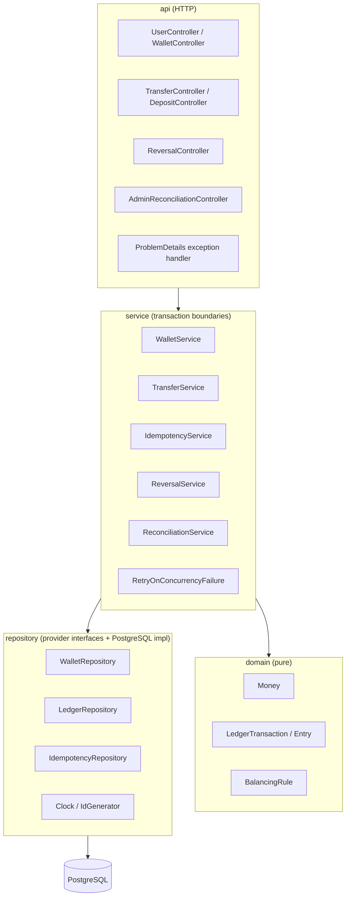
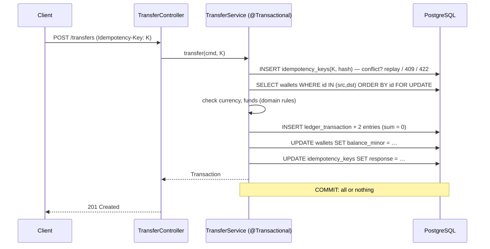
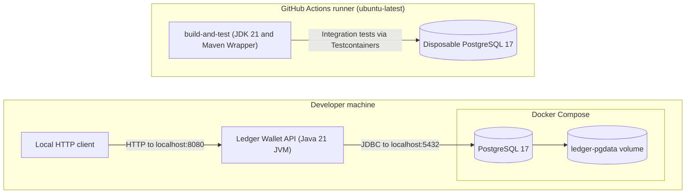

# Architecture and Design

> **Status:** preliminary outline from Stage 1. The full design (ER diagram, sequence diagrams,
> provider interfaces) is the Stage 2 deliverable (SE-2, tasks T2.2, T2.6, T2.10 and T2.13 in
> `IMPLEMENTATION_PLAN.md`). Diagrams are written in Mermaid so that they render on GitHub and in
> Obsidian, and source copies live in `diagrams/`.

## 1. Goals that shape the design

1. **Correctness over everything:** balanced transactions, no lost updates, immutable history
   (FR-3, FR-4, NFR-INT-*).
2. **The database is the last line of defence:** constraints and triggers enforce the invariants
   even if application code is wrong.
3. **Testable layers:** domain rules are pure Java and unit-tested. Persistence sits behind
   interfaces (SE-6).

## 2. Component view

## 3. Key design questions for Stage 2 (become ADRs)

| Question | Leading option | ADR |
|---|---|---|
| Ledger schema and sign convention | `ledger_transactions` + `ledger_entries` with signed `amount_minor`; cached `wallets.balance_minor` | 0005 |
| Concurrency | `SELECT … FOR UPDATE` on both wallets ordered by id, READ COMMITTED, retry on 40P01/40001 | 0006 |
| Idempotency | `idempotency_keys` row inserted in the same transaction; SHA-256 fingerprint; 24 h retention | 0007 |
| Immutability | `BEFORE UPDATE OR DELETE` row triggers and a `BEFORE TRUNCATE` trigger raising an exception; per-wallet HMAC hash chain (FR-4.6) | 0008 |
| Data access | `JdbcClient` (explicit SQL, visible locks) vs. JPA | 0009 |

## 4. Transfer flow (draft)

## 5. Deployment view

The local API runs on the developer's JVM. Docker Compose starts PostgreSQL and stores its data
in the `ledger-pgdata` volume. CI runs integration tests against a separate PostgreSQL container.
[Mermaid source](diagrams/deployment.mmd)

- **Local.** `./mvnw spring-boot:run` starts the PostgreSQL service defined in
  [`compose.yaml`](../compose.yaml). The API accepts HTTP requests on port 8080 by default.
- **CI.** The [workflow](../.github/workflows/ci.yml) runs on pushes and pull requests. The
  `build-and-test` job runs lint and Maven verification. `secret-scan` and `validate-docs` run as
  separate jobs. The CI test database is created for the test run (TQ-5, NFR-DB-3).

The release 1.0 deployment target is local. Deployment beyond the developer machine remains
open under TBD-3.
