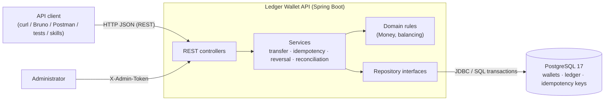
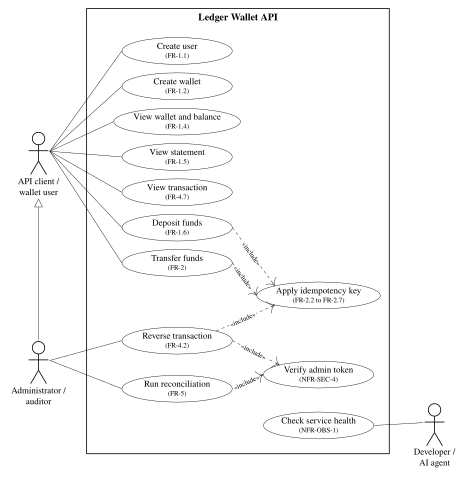
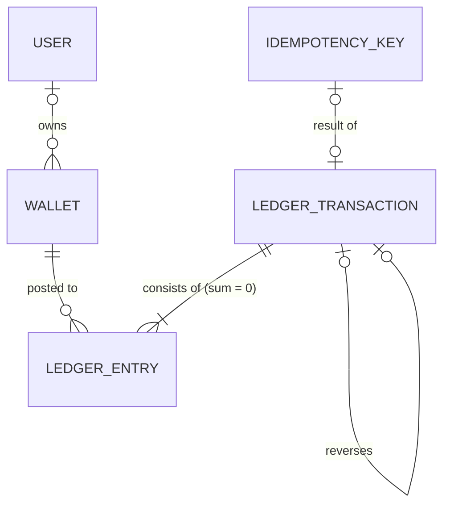

# Software Requirements Specification for Ledger Wallet API

**Version 1.3 (Stage 1)**

**Prepared by:** Pranav Goyal, Aprajita Agarwal, Rudra Hardik Shroff, Tanuj Hardikkumar Shah

**Organization:** Team TRAP

**Date created:** 2026-11-08

## Table of Contents

1. [Introduction](#1-introduction)
2. [Overall Description](#2-overall-description)
3. [External Interface Requirements](#3-external-interface-requirements)
4. [System Features](#4-system-features)
5. [Other Nonfunctional Requirements](#5-other-nonfunctional-requirements)
6. [Other Requirements](#6-other-requirements)
- [Appendix A: Glossary](#appendix-a-glossary)
- [Appendix B: Analysis Models](#appendix-b-analysis-models)
- [Appendix C: To Be Determined List](#appendix-c-to-be-determined-list)

## Revision History

| Name | Date | Reason For Changes | Version |
|---|---|---|---|
| Pranav Goyal | 2026-10-28 | Initial draft for Stage 1 | 0.1 |
| Aprajita Agarwal | 2026-11-02 | Fixes from team review: idempotency, hash chain, system accounts, error codes, amount limit, traceability; closed TBD-1, TBD-2, TBD-5, TBD-6 | 0.2 |
| Rudra Hardik Shroff | 2026-11-04 | Fixes from team review: admin-only reversals, HMAC key rules, system-account entries, SK-5 pass rule, error codes, CI brain checks, references | 0.3 |
| Tanuj Hardikkumar Shah | 2026-11-08 | Fixes from team review: 401 handling and reversal check order, development and test HMAC key, HMAC key check at startup, reference details | 0.4 |
| Pranav Goyal | 2026-11-09 | Named the table that holds the HMAC key check value (NFR-DB-1) | 0.5 |
| Pranav Goyal, Aprajita Agarwal, Rudra Hardik Shroff, Tanuj Hardikkumar Shah | 2026-11-09 | Team review and approval | 1.0 |
| Pranav Goyal | 2026-11-09 | Fixes from team review (Rudra Hardik Shroff): idempotency key scope and expiry, email rules, system account creation, hash chain format, database privilege boundary, entry currency constraint | 1.1 |
| Pranav Goyal | 2026-11-09 | Wording fixes from team review: late-retry rule (FR-2.7, A-4), ADR-0008 reference, email syntax | 1.2 |
| Pranav Goyal | 2026-11-09 | FR-4.1 no longer claims detection of every privileged change (team review, Rudra Hardik Shroff) | 1.3 |
| Pranav Goyal, Aprajita Agarwal, Rudra Hardik Shroff, Tanuj Hardikkumar Shah | 2026-11-28 | Approved v1.3 as the Stage 1 implementation baseline. [Team sign-off in PR #11](https://github.com/pranavg18/ledger-wallet-api/pull/11). | 1.3 |

---

## 1. Introduction

### 1.1 Purpose

This document specifies the software requirements for **Ledger Wallet API, release 1.0**. It is a
backend service that manages user wallets and records every movement of money in a tamper-evident,
double-entry ledger. The SRS covers the whole product: the REST API, the persistence layer, the
administrative reconciliation function, and the engineering requirements for the Agent Skills
that support the team's workflow. It doesn't cover any client application (web or mobile UI),
which is out of scope.

### 1.2 Document Conventions

- Requirement IDs are unique and stable. They are never reused or renumbered:
  - `FR-n` / `FR-n.m`: functional requirements. `FR-1` to `FR-5` are the five requirements from the
    project brief, and `FR-n.m` refines them.
  - `NFR-<CAT>-n`: non-functional requirements (INT integrity, CON concurrency, PERF performance,
    SEC security, REL reliability, MNT maintainability, OBS observability, PORT portability, USE
    usability, DOC documentation, DB database).
  - `SK-n`: Agent Skill requirements. `TQ-n`: testing and quality requirements (TQ-1 to TQ-6 and
    TQ-9 come from the brief, TQ-7 and TQ-8 from the SDLC document).
  - `BR-n` business rules, `C-n` constraints, `A-n` assumptions and `TBD-n` open items are local to
    this document. `SE-n` and `SB-n` cite requirements of the SDLC document (reference 2).
- **Priority** is High, Medium or Low. A detailed requirement inherits its parent feature's
  priority unless it states its own. Requirements in sections 5 and 6 are High unless stated.
- "shall" means mandatory, "should" means desirable, and "may" means optional.
- Monetary examples use INR. `amountMinor` values are in paise (1 INR = 100 paise).
- `TBD` items are tracked in [Appendix C](#appendix-c-to-be-determined-list).

### 1.3 Intended Audience and Reading Suggestions

| Reader | Read first | Then |
|---|---|---|
| Developers (team members) | 2, 4 | 5, 6, Appendix B |
| Testers / QA | 4 (each requirement is written to be verifiable) | 5, `docs/testing.md` |
| Course reviewers / instructors | 1, 2.2 | 4 summaries, `docs/traceability.md` |
| AI coding agents | `AGENTS.md`, then 4 and 5.5 (business rules) | |

Section 2 describes the product at a high level. Section 3 defines the interfaces. Section 4 holds
the detailed functional requirements, grouped by feature. Section 5 holds the non-functional
requirements and business rules. Section 6 covers the database, the Agent Skills, and testing and
quality.

### 1.4 Product Scope

In poorly designed systems, concurrent balance updates overwrite each other, and a network retry
can charge a customer twice. Ledger Wallet API treats money as a verifiable fact rather than a
mutable number:

- every credit has an equal and opposite debit (double-entry);
- retried requests never move money twice (idempotency keys);
- concurrent requests never corrupt a balance (database-level locking);
- history is never edited, and corrections are explicit reversals (immutable audit trail);
- an administrator can prove at any time that the books balance (reconciliation).

The educational goal is to show core computer-science principles (ACID transactions, data
integrity, idempotency, clean API design) inside a maintainable, well-documented, well-tested
codebase built by a team with AI assistance.

### 1.5 References

1. Course instructors, *Project Statement: Financial Ledger & Digital Wallet API*, October 2026.
   Local copy: `docs/course/Project_2_Financial_Ledger.pdf`.
2. Course instructors, *The AI-Assisted Software Development Life Cycle (SDLC)*, October 2026.
   Local copy: `docs/course/SDLC_and_Workflow.pdf`.
3. K. E. Wiegers, *Software Requirements Specification* template (IEEE format), 1999, supplied with
   the course materials. Local copy: `docs/course/srs_template-ieee.doc`.
4. IETF, *The Idempotency-Key HTTP Header Field* (Internet-Draft),
   https://datatracker.ietf.org/doc/draft-ietf-httpapi-idempotency-key-header/
5. RFC 9457, *Problem Details for HTTP APIs*, https://www.rfc-editor.org/rfc/rfc9457
6. PostgreSQL 17 documentation, chapter 13 *Concurrency Control*,
   https://www.postgresql.org/docs/17/mvcc.html
7. ISO 4217, *Codes for the representation of currencies*. Official code list from the
   maintenance agency (SIX): https://www.six-group.com/en/products-services/financial-information/market-reference-data/data-standards.html
8. Team brain notes: `brain/resources/double-entry-bookkeeping.md`, `idempotency-keys.md`,
   `postgresql-concurrency-control.md`, `money-as-integer-minor-units.md`.
9. Architecture Decision Records: `docs/adr/`.
10. *Agent Skills specification*, https://agentskills.io/specification

References 1 to 3 are issued to students by the course instructors. The local copies are
git-ignored, so they are not in the repository.

---

## 2. Overall Description

### 2.1 Product Perspective

This is a new, self-contained backend product. It has no predecessor and does not integrate with
real banks or payment networks. Money enters the system only through a simulated deposit that
debits an internal *system funding account*.

### 2.2 Product Functions

- **Wallet management**: create users and one wallet per user per currency; view balances and
  statements (FR-1).
- **Funding**: deposit simulated external money into a wallet (FR-1.6).
- **Idempotent transfers**: move money between two wallets of the same currency, safely retryable
  (FR-2).
- **Concurrency safety**: correct balances under simultaneous transfers (FR-3).
- **Immutable audit trail and reversals**: append-only ledger, with corrections as reversal
  transactions (FR-4).
- **Reconciliation**: an admin report proving that debits equal credits and that cached balances
  match the ledger (FR-5).
- **Health check**: liveness and readiness of the service and its database (NFR-OBS-1).

The use case diagram below shows who can use each function (user classes are described in 2.3).
An administrator can do everything an API client can, plus reversals and reconciliation.
«include» marks a step that several use cases share. The diagram's source is
`docs/diagrams/use-case.tex`.

### 2.3 User Classes and Characteristics

| User class | Description | Privileges | Importance |
|---|---|---|---|
| **API client / wallet user** | Software acting for an end user (test client, script, future app). Technically skilled, uses JSON over HTTP | Create users and wallets, deposit, transfer, read wallets and transactions | Primary |
| **Administrator / auditor** | Operator who corrects the ledger and verifies its integrity | All of the above plus reversals and reconciliation | Secondary |
| **Developer / AI agent** | Team members and Claude Code working on the codebase | Local environment, skills, test data | Secondary |

Release 1.0 has no end-user authentication. Client calls are trusted. Only the operator actions,
reversals (FR-4.2) and reconciliation (FR-5.1), require `X-Admin-Token`. This is an accepted risk
for a course deployment: any client can read, fund or transfer from any wallet.

### 2.4 Operating Environment

- **Runtime:** Java 21 (LTS) JVM. Spring Boot 4.1. Runs on macOS, Linux and Windows (NFR-PORT-1).
- **Database:** PostgreSQL 17, run locally through Docker Compose and in tests through
  Testcontainers.
- **CI:** GitHub Actions `ubuntu-latest` runners. macOS and Windows (NFR-PORT-1) are checked by
  running `local-check` (SK-4) on team members' machines, because GitHub's hosted macOS and
  Windows runners don't provide the Docker Linux containers the integration tests need.
- **Clients:** any HTTP/1.1 client (curl, Bruno, Postman, Python scripts in the skills).
- **Deployment:** release 1.0 runs locally on a developer machine. Anything beyond that (a Docker
  image, a hosted demo) is TBD-3.

### 2.5 Design and Implementation Constraints

- **C-1** Language and framework: Java 21 + Spring Boot, built with Maven (ADR-0002).
- **C-2** Database: PostgreSQL. Schema managed only through versioned Flyway migrations (ADR-0003).
  The course brief encourages SQLite. The team chose PostgreSQL deliberately for row-level locking
  and production realism (ADR-0003 records the trade-off).
- **C-3** Monetary amounts are integers in minor units (ADR-0004). Floating-point types are
  forbidden for money.
- **C-4** External dependencies (database, clock, ID generation) shall sit behind provider
  interfaces (SE-6).
- **C-5** All work is tracked in GitHub Issues, every change goes through a reviewed pull request,
  and CI must pass before merge.
- **C-6** AI assistants may be used. A human reviews every AI-generated change, and no secrets are
  shared with AI tools.

### 2.6 User Documentation

- `README.md`: overview and quick start.
- `docs/user-guide.md`: how to run the API and perform every operation with example requests.
- `docs/openapi.yaml`: OpenAPI 3.1 contract, served as Swagger UI in a later stage (TBD-4).
- `api-client/`: Bruno collection for manual testing and the live demo (Stage 3).
- `AGENTS.md` and `.claude/skills/*/SKILL.md`: developer and AI-agent documentation.

### 2.7 Assumptions and Dependencies

- **A-1** Team members can run Docker locally. Integration tests and the local database depend on
  it.
- **A-2** One currency per wallet. No currency conversion (FX) in release 1.0.
- **A-3** A single service instance (no horizontal scaling). Correctness does not depend on this:
  PostgreSQL row locks and unique constraints work across any number of instances, so no
  distributed locks are needed.
- **A-4** Clients generate unique idempotency keys (UUID v4 recommended) and do not retry an
  operation more than 24 hours after first sending it (FR-2.7).
- **A-5** Dependencies: Spring Boot, PostgreSQL JDBC driver, Flyway, Testcontainers. All are open
  source and pinned in `pom.xml`.

---

## 3. External Interface Requirements

### 3.1 User Interfaces

There is no graphical UI. The product's "user interface" is the HTTP API (3.3). Every error
response shall use the RFC 9457 `application/problem+json` format with a stable, machine-readable
`code` (NFR-USE-1).

### 3.2 Hardware Interfaces

None. The product runs on commodity hardware and has no device interfaces.

### 3.3 Software Interfaces

| Interface | Detail |
|---|---|
| REST API | JSON over HTTP, base path `/api/v1`. Contract: `docs/openapi.yaml` |
| PostgreSQL 17 | JDBC (`org.postgresql` driver). Transactions with row-level locks. Flyway migrations |
| Actuator | `GET /actuator/health` (read-only), used by `local-check` |

**Endpoint summary** (details in `docs/openapi.yaml`):

| Method | Path | Purpose | Idempotency-Key |
|---|---|---|---|
| POST | `/api/v1/users` | Create user | n/a |
| POST | `/api/v1/users/{userId}/wallets` | Create wallet in a currency | n/a |
| GET | `/api/v1/wallets/{walletId}` | Wallet details and balance | n/a |
| GET | `/api/v1/wallets/{walletId}/entries` | Ledger entries (statement), paginated | n/a |
| POST | `/api/v1/deposits` | Fund a wallet from the system account | **required** |
| POST | `/api/v1/transfers` | Transfer between wallets | **required** |
| GET | `/api/v1/transactions/{transactionId}` | Transaction with its entries | n/a |
| POST | `/api/v1/transactions/{transactionId}/reversals` | Reverse a transaction (admin) | **required** |
| GET | `/api/v1/admin/reconciliation` | Reconciliation report (admin) | n/a |

### 3.4 Communications Interfaces

- HTTP/1.1, JSON encoded as UTF-8. Request bodies with unknown fields are rejected (NFR-SEC-1).
- Headers: `Idempotency-Key` (client to server), `Idempotent-Replayed: true` (server to client, on
  replays), `X-Admin-Token` (admin endpoints).
- Identifiers are UUIDs. Timestamps are ISO 8601 in UTC.
- TLS termination is out of scope for local and course deployments (TBD-3).

---

## 4. System Features

### 4.1 User and Wallet Management (FR-1)

#### 4.1.1 Description and Priority

**FR-1** (Wallet Initialization): The system shall create user accounts with distinct currency
wallets, and every balance shall be backed by double-entry ledger entries. **Priority: High.**

#### 4.1.2 Stimulus/Response Sequences

1. Client `POST /users` with name and email → 201 with the user `id`.
2. Client `POST /users/{id}/wallets` with `currency: "INR"` → 201 with the wallet, `balanceMinor: 0`.
3. Client `POST /deposits` with an Idempotency-Key, wallet and amount → 201 with a transaction of
   two entries (system account −amount, wallet +amount).
4. Client `GET /wallets/{id}` → balance equal to the sum of the wallet's entries.

#### 4.1.3 Functional Requirements

- **FR-1.1** The system shall create a user from a `name` (1–100 characters) and a unique `email`.
  Leading and trailing whitespace is trimmed from the email, which must then be a syntactically
  valid address (exactly one `@` with non-empty text on both sides, and no spaces) of at most 254
  characters. Uniqueness ignores letter case, so `A@x.com` and
  `a@x.com` are the same user. A duplicate email returns 409 `EMAIL_ALREADY_EXISTS`.
- **FR-1.2** The system shall create a wallet for an existing user in a supported currency: a
  valid ISO 4217 code from a configured list (initially INR, USD and EUR, which all have a minor
  unit). A second wallet for the same user and currency returns 409 `WALLET_ALREADY_EXISTS`. An
  unknown user returns 404. An invalid or unsupported currency returns 400.
- **FR-1.3** A new wallet's balance shall be 0. No endpoint shall set a balance directly. Balances
  change only by posting ledger transactions.
- **FR-1.4** `GET /wallets/{id}` shall return id, owner, currency, `balanceMinor` and creation
  time.
- **FR-1.5** `GET /wallets/{id}/entries` shall return the wallet's ledger entries, newest first,
  with cursor pagination (default 50, max 200).
- **FR-1.6** `POST /deposits` shall fund a wallet by posting one transaction: a debit on the
  currency's system funding account and an equal credit on the wallet. The body has `walletId`,
  `amountMinor`, `currency` and an optional `description` (≤ 255 characters). An unknown wallet
  returns 404, and a currency that differs from the wallet's returns 422 `CURRENCY_MISMATCH`. It
  requires an Idempotency-Key and follows the same rules as FR-2.2 to FR-2.7 and FR-2.10.
- **FR-1.7** The system shall maintain one internal system funding account per supported
  currency. System accounts are not owned by users and may hold a negative balance. They are
  internal: the API treats a request naming one as naming an unknown wallet (404), so a system
  account can never be the source or destination of a transfer or the target of a deposit. Their
  entries still appear in transaction responses, marked `systemAccount: true`, and looking up such
  a wallet ID returns 404 by design. A system account shall exist for every supported currency
  before the service accepts requests (e.g. created at startup if missing, by an insert that does
  nothing when the account already exists), so a deposit never fails for lack of one.

### 4.2 Idempotent Transfers (FR-2)

#### 4.2.1 Description and Priority

**FR-2** (Idempotent Transfers): The system shall transfer funds between two wallets. The endpoint
shall require an idempotency key (header), so retried network requests never double-charge an
account. **Priority: High.**

#### 4.2.2 Stimulus/Response Sequences

1. Client `POST /transfers` with an `Idempotency-Key: K` and a body → 201 with a transaction.
2. The network drops the response. The client retries with the same K and the same body → the
   **same** 201 response, header `Idempotent-Replayed: true`, and no new entries.
3. The client mistakenly reuses K with a different body → 422 `IDEMPOTENCY_KEY_REUSED`.

#### 4.2.3 Functional Requirements

- **FR-2.1** `POST /transfers` shall accept `sourceWalletId`, `destinationWalletId`, `amountMinor`
  (positive integer), `currency` and optional `description` (≤ 255 characters).
- **FR-2.2** The request shall include an `Idempotency-Key` header of 1–255 printable ASCII
  characters. A missing header returns 400 `IDEMPOTENCY_KEY_MISSING`. A malformed one returns 400
  `IDEMPOTENCY_KEY_INVALID`. Keys are global: one key identifies one operation across all
  money-moving endpoints, so reusing a key on another endpoint returns 422
  `IDEMPOTENCY_KEY_REUSED` (the fingerprint includes the method and path, FR-2.10).
- **FR-2.3** A request repeating a stored key with an identical request fingerprint shall return
  the stored status and body unchanged, with `Idempotent-Replayed: true`, and shall create no
  ledger entries.
- **FR-2.4** A request repeating a stored key with a different fingerprint shall return 422
  `IDEMPOTENCY_KEY_REUSED` and change nothing.
- **FR-2.5** A request whose key belongs to a request still being processed shall return 409
  `IDEMPOTENCY_REQUEST_IN_PROGRESS` without waiting for that request to finish (e.g. using a
  non-blocking lock on the key, such as a PostgreSQL advisory lock).
- **FR-2.6** The idempotency record shall be committed in the same database transaction as the
  operation's ledger writes, if any. It stores the first completed response: a success, or a
  rejection by a business rule (404, 409 or 422). Input-validation errors (400), authentication
  errors (401), the responses of FR-2.4 and FR-2.5, and failures that roll back (5xx) leave no
  record, so the client may retry with the same key.
- **FR-2.7** Idempotency records shall be retained for at least 24 hours, so a retry within 24 hours
  is always replayed. Once a record has been purged, its key is treated as new, so a retry after
  that may move money again. This is an accepted limit: clients do not retry an operation more
  than 24 hours after first sending it (A-4).
- **FR-2.8** A successful transfer shall post exactly one transaction with exactly two entries: a
  debit of `amountMinor` on the source and a credit of `amountMinor` on the destination.
- **FR-2.9** The transfer shall be rejected with no ledger change if: the wallets are the same (422
  `SAME_WALLET`); either wallet doesn't exist or is a system account (404, FR-1.7); the currency
  differs from either wallet's (422 `CURRENCY_MISMATCH`); or the source balance is less than the
  amount (422 `INSUFFICIENT_FUNDS`). The checks run in this order, and the first failure is
  returned.
- **FR-2.10** The request fingerprint shall be a SHA-256 hash of the HTTP method, the path and the
  canonical JSON body, so key order and whitespace do not matter.

### 4.3 Concurrent Balance Mutability (FR-3)

#### 4.3.1 Description and Priority

**FR-3** (Concurrent Balance Mutability): The system shall safely handle multiple simultaneous
incoming and outgoing transfers on the same wallet without race conditions or balance corruption.
**Priority: High.**

#### 4.3.2 Stimulus/Response Sequences

1. Wallet A holds 9000. Two clients each send A→B 6000 at the same instant.
2. One request returns 201. The other waits for the first to commit, re-checks the funds, and
   returns 422 `INSUFFICIENT_FUNDS`.
3. Final A = 3000, B = 6000 more than before, and reconciliation is BALANCED.

#### 4.3.3 Functional Requirements

- **FR-3.1** The outcome of any set of concurrent money-moving operations (deposits, transfers and
  reversals) shall equal the outcome of some serial order of the same operations (serialisability
  per wallet).
- **FR-3.2** No sequence of concurrent requests shall make a user wallet's balance negative.
- **FR-3.3** Concurrent operations on the same wallets, such as transfers in opposite directions
  (A→B and B→A) or a reversal running beside a transfer, shall not deadlock. Every money-moving
  operation shall take its wallet locks in one deterministic order (e.g. ascending wallet ID).
- **FR-3.4** If the database aborts a transaction for a serialisation failure or deadlock
  (SQLSTATE 40001 / 40P01), the system shall retry it up to 3 times. After that it returns 503
  `CONCURRENCY_RETRY_EXHAUSTED`.
- **FR-3.5** Transfers that touch disjoint wallets shall not block each other.

### 4.4 Immutable Audit Trail and Reversals (FR-4)

#### 4.4.1 Description and Priority

**FR-4** (Immutable Audit Trail): Ledger records cannot be updated or deleted once written. Any
correction or cancellation shall be recorded as an explicit reversal transaction.
**Priority: High** (FR-4.6: Medium).

#### 4.4.2 Stimulus/Response Sequences

1. Admin `POST /transactions/{id}/reversals` with a valid `X-Admin-Token`, an Idempotency-Key and
   a reason → 201 with a new REVERSAL transaction whose entries mirror the original's.
2. Reversing the same transaction again → 409 `ALREADY_REVERSED`.
3. Any SQL `UPDATE`, `DELETE` or `TRUNCATE` on ledger tables (even by a developer at the psql
   prompt) → error raised by the database.

#### 4.4.3 Functional Requirements

- **FR-4.1** The database shall reject every `UPDATE`, `DELETE` and `TRUNCATE` on the ledger
  transaction and entry tables (e.g. with triggers). This shall hold even for SQL that bypasses the
  application. The application shall connect as a database role that does not own these tables,
  so it cannot disable that protection. A superuser or the tables' owner can still disable it;
  preventing that is outside the system's threat model. FR-4.6 and FR-5.5 detect the resulting
  changes instead, except the deletion of a wallet's newest entries, which FR-4.6 cannot detect.
- **FR-4.2** `POST /transactions/{id}/reversals` shall post a new transaction of type `REVERSAL`
  that references the original and whose entries are the original's entries with their signs
  flipped. The body has a required `reason` (1–255 characters). It requires a valid
  `X-Admin-Token` (NFR-SEC-4), checked before anything else, and an Idempotency-Key (FR-2.2 to
  FR-2.7 and FR-2.10 apply).
- **FR-4.3** A transaction shall be reversible at most once, even under concurrent requests (409
  `ALREADY_REVERSED`, backed by a database constraint, NFR-DB-2). A reversal transaction shall not
  itself be reversible (422 `CANNOT_REVERSE_REVERSAL`).
- **FR-4.4** A reversal shall be rejected with 422 `INSUFFICIENT_FUNDS` if it would make a user
  wallet negative (e.g. the recipient already spent the money). This check runs after those of
  FR-4.3.
- **FR-4.5** Every transaction shall record its type (`DEPOSIT`, `TRANSFER`, `REVERSAL`), creation
  time (UTC), description or reason, and idempotency key. Every entry shall record the
  transaction, wallet, signed amount and currency.
- **FR-4.6** *(Medium)* The ledger shall be tamper-evident. Each entry shall store an HMAC-SHA-256
  of its own content, its transaction's content and the hash of the wallet's previous entry (a
  per-wallet hash chain, ordered by a sequence number because timestamps can tie). The key comes
  from the `LEDGER_HMAC_KEY` environment variable and is never stored in the database, so someone
  with database access alone cannot rebuild the chain, and FR-5.5 detects any entry changed,
  inserted or deleted out of band. The one exception is deleting a wallet's newest entries, which
  would need a copy of the chain head outside the database (out of scope for 1.0). The service
  shall refuse to start if the key is unset or empty, or if it differs from the key the ledger was
  created with (checked against a stored HMAC of a fixed string; key rotation is out of scope for
  1.0). A wallet's chain grows only under the wallet locks FR-3.3 already takes, so FR-3.5 still
  holds. The chain format (each chain's starting value, the exact fields, their byte encoding and
  the fixed string for the key check) is to be recorded in ADR-0008 and shall not change once
  entries exist.
- **FR-4.7** `GET /transactions/{id}` shall return the transaction (id, type, creation time,
  description or reason, and the id of the transaction it reverses, if any) with all its entries.

### 4.5 Ledger Reconciliation (FR-5)

#### 4.5.1 Description and Priority

**FR-5** (Ledger Reconciliation): An administrative endpoint shall scan the ledger entries and
verify that the sum of credits equals the sum of debits, and that current wallet balances match
the calculated ledger sums. **Priority: High** (FR-5.5: Medium).

#### 4.5.2 Stimulus/Response Sequences

1. Admin `GET /admin/reconciliation` with a valid `X-Admin-Token` → 200 report, `status: BALANCED`.
2. A DBA manually corrupts a cached balance → the next report shows `status: DISCREPANCY` and lists
   the wallet with its expected and actual balance.
3. Request without a valid token → 401.

#### 4.5.3 Functional Requirements

- **FR-5.1** `GET /admin/reconciliation` shall require a valid `X-Admin-Token` (NFR-SEC-4) and
  shall not modify any data. All its checks shall read one consistent snapshot (e.g. a single
  read-only `REPEATABLE READ` transaction), so transfers committing during the scan cannot cause
  false discrepancies.
- **FR-5.2** It shall verify, per currency, that the sum of all entry amounts is zero (total
  debits = total credits).
- **FR-5.3** It shall verify that every transaction's entries sum to zero.
- **FR-5.4** It shall verify that every wallet's stored balance equals the sum of its entries.
- **FR-5.5** *(Medium)* It shall verify every wallet's hash chain (FR-4.6).
- **FR-5.6** The report shall contain: `status` (`BALANCED` | `DISCREPANCY`), `checkedAt`, counts of
  transactions, entries and wallets, per-currency debit and credit totals (both non-negative, and
  equal when balanced), and a list of discrepancies (type, id, expected, actual).

---

## 5. Other Nonfunctional Requirements

### 5.1 Performance Requirements

- **NFR-PERF-1** On a developer laptop with local PostgreSQL, a transfer shall complete in under
  200 ms at the 95th percentile with 20 concurrent clients using distinct wallet pairs.
- **NFR-PERF-2** Reconciliation over 100,000 entries shall complete in under 5 seconds.
- **NFR-PERF-3** Wallet balance reads shall not scan the ledger. They read the cached balance kept
  consistent by NFR-INT-4.

### 5.2 Safety Requirements

Here, "safety" means preventing financial loss or corruption.

- **NFR-INT-1** Every ledger transaction shall balance: its entries sum to zero per currency.
  Unbalanced transactions shall be rejected before they are written.
- **NFR-INT-2** All monetary amounts shall be integers in the currency's minor unit (`long` in
  Java, `BIGINT` in SQL, integer in JSON). Floating-point types shall not be used for money
  anywhere (TQ-6).
- **NFR-INT-3** Ledger tables shall be append-only, enforced by the database (FR-4.1).
- **NFR-INT-4** A wallet's cached balance and its ledger entries shall be written in the same
  database transaction. After any commit, balance = Σ entries.
- **NFR-INT-5** User wallet balances shall never be negative. A database `CHECK` constraint shall
  back up the application check.
- **NFR-CON-1** Concurrency control shall use database row-level locking or serialisable
  transactions. Application-level read-modify-write of balances without a lock is forbidden.
- **NFR-REL-1** Any error that aborts a money-moving operation (a 5xx response) shall roll back all
  of its writes (ledger entries, balances and idempotency record). Partial transfers shall be
  impossible.
- **NFR-REL-2** Idempotency records and ledger data shall survive application restarts (they are
  persisted in PostgreSQL).

### 5.3 Security Requirements

- **NFR-SEC-1** All API inputs (path IDs, query parameters, headers, bodies) shall be validated.
  Malformed UUIDs, unknown JSON fields, wrong types and out-of-range values return 400 with a
  problem response.
- **NFR-SEC-2** Amounts shall be integers from 1 to 10¹² minor units (`1 ≤ amountMinor ≤ 10¹²`).
  Zero, negative, fractional, non-numeric and larger amounts return 400. This prevents balance
  inflation through negative transfers and keeps each request amount exact in JavaScript clients.
  Balance arithmetic shall be overflow-checked, so an overflow aborts the operation with a 500
  error instead of wrapping.
- **NFR-SEC-3** No secrets shall be committed. CI shall run secret scanning on every push and PR.
  Configuration secrets come from environment variables.
- **NFR-SEC-4** Administrative endpoints shall require an `X-Admin-Token` header matching the
  `ADMIN_TOKEN` environment variable, compared in constant time. A missing or invalid token returns
  401. If `ADMIN_TOKEN` is unset or empty, every admin request is rejected (fail closed).
- **NFR-SEC-5** Error responses shall not expose stack traces, SQL or internal class names.
- **NFR-SEC-6** All SQL shall use bound parameters. String concatenation of user input into SQL is
  forbidden.

### 5.4 Software Quality Attributes

- **NFR-MNT-1** Layered architecture (`api` → `service` → `domain`/`repository`). Business logic
  never depends on HTTP or SQL details directly. Persistence, clock and ID generation sit behind
  interfaces (SE-6).
- **NFR-MNT-2** Code style is enforced automatically (Spotless / google-java-format), and CI fails
  on violations.
- **NFR-MNT-3** Line coverage of `domain` and `service` packages shall be at least 80% (measured
  from Stage 3).
- **NFR-MNT-4** Schema changes happen only through new versioned Flyway migrations. Merged
  migrations are never edited.
- **NFR-OBS-1** The service shall expose `GET /actuator/health`, reporting UP only when the
  database is reachable.
- **NFR-OBS-2** Every money-moving request shall be logged with its transaction id (if any), type
  and outcome. Logs shall not contain secrets or full request bodies.
- **NFR-PORT-1** The project shall build, test and run on macOS, Linux and Windows with only a JDK
  21+ and Docker installed (`./mvnw` provides Maven). For this, local runs and tests use a fixed,
  non-secret `LEDGER_HMAC_KEY` that the project provides (FR-4.6); every other environment sets
  its own key.
- **NFR-USE-1** Errors shall use RFC 9457 problem details with a stable `code` field (e.g.
  `INSUFFICIENT_FUNDS`), so clients can branch on it. Where section 4 names no code, invalid input
  returns 400 `VALIDATION_FAILED`, an unknown user, wallet or transaction returns 404
  `USER_NOT_FOUND`, `WALLET_NOT_FOUND` or `TRANSACTION_NOT_FOUND`, a missing or invalid admin token
  returns 401 `ADMIN_TOKEN_INVALID`, and an unexpected server error returns 500 `INTERNAL_ERROR`.
- **NFR-DOC-1** The OpenAPI contract shall be kept in sync with the implemented endpoints. CI shall
  fail if they drift (from Stage 3, TBD-4).
- **NFR-DOC-2** On every pull request, CI shall validate the brain notes (frontmatter schema and
  wikilinks) and check that every ADR cites at least one brain note (SB-3).

### 5.5 Business Rules

- **BR-1** Money cannot be created or destroyed. It moves only between accounts through balanced
  transactions.
- **BR-2** Only system funding accounts may hold negative balances.
- **BR-3** A transfer is in a single currency. Both wallets must hold that currency.
- **BR-4** History is never rewritten. A mistake is corrected with a reversal, and the original
  stays visible.
- **BR-5** Only administrators may reverse transactions or run reconciliation.

---

## 6. Other Requirements

### 6.1 Database Requirements

- **NFR-DB-1** PostgreSQL 17. Tables: `users`, `wallets`, `ledger_transactions`, `ledger_entries`,
  `idempotency_keys` and `ledger_metadata` (to be detailed in the Stage 2 ER diagram).
  `ledger_metadata` holds the HMAC key check value (FR-4.6). System funding accounts (FR-1.7) are
  rows in `wallets` with no owner (`user_id` is NULL).
- **NFR-DB-2** Integrity constraints in the database, not only in code: foreign keys; `UNIQUE NULLS
  NOT DISTINCT (user_id, currency)` on wallets (one wallet per user per currency, and one system
  account per currency); `UNIQUE (id, currency)` on wallets, referenced by a foreign key on
  entries' `(wallet_id, currency)`, so an entry's currency always matches its wallet's; `CHECK
  (amount_minor <> 0)` on entries; `CHECK (user_id IS NULL OR balance_minor >= 0)` on wallets; a
  unique index on `lower(email)` on users (FR-1.1); and `UNIQUE` on the reversed-transaction
  reference (FR-4.3).
- **NFR-DB-3** Tests run against an isolated, throwaway PostgreSQL instance (Testcontainers),
  never a shared database (TQ-5).

### 6.2 Agent Skill Requirements

- **SK-1 brain-ingest**: add a source to the brain as a distilled, linked note in `brain/inbox/`
  and log the run.
- **SK-2 brain-refine**: file inbox notes into PARA, merge duplicates, fix links, update MOCs and
  log.
- **SK-3 brain-query**: answer questions and draft documents (SRS, ADRs) from brain notes, citing
  them with wikilinks.
- **SK-4 local-check**: build, run the tests, start the server, call one read-only endpoint, and
  report PASS/FAIL per step.
- **SK-5 simulate-transfer**: create two users with one wallet each and fund the first with a
  deposit (new wallets start at 0, FR-1.3), record balances, make an idempotent transfer and replay
  it, fire two concurrent transfers with different idempotency keys that the source balance covers
  one at a time but not together (as in 4.3.2), reconcile (reading `ADMIN_TOKEN` from the
  environment), and summarise. It reports PASS only if the replay moved no money, exactly one
  concurrent transfer succeeded, neither wallet went negative, and reconciliation is `BALANCED`.
- **SK-6** Every skill shall conform to the Agent Skills specification (name = folder, valid
  frontmatter). CI validates this on every PR.
- **SK-7** Every skill shall cite at least one brain note (SB-3).
- **SK-8** Skill evaluations shall run before each stage submission, with results recorded in
  `docs/testing.md` (TQ-7).

### 6.3 Testing and Quality Requirements (from the brief and the SDLC document)

- **TQ-1** Unit tests for accounting calculations, ledger balance assertions and idempotency key
  hashing.
- **TQ-2** Integration tests for database transactions and rollback on simulated transfer failures.
- **TQ-3** System (end-to-end) tests for each of FR-1 to FR-5.
- **TQ-4** Negative tests: negative balance attempts, insufficient funds, invalid idempotency
  payloads, malformed IDs, and simultaneous concurrent transfers (race safety).
- **TQ-5** CI tests run against an isolated test database on every push.
- **TQ-6** Tests prove that money is handled as integer minor units, with no floating-point
  rounding.
- **TQ-7** Skill evaluations run before each stage submission and are recorded.
- **TQ-8** Tests are maintained as the system changes. Each significant defect gets a regression
  test.
- **TQ-9** Security tests (the brief's unnumbered "Security Testing" item): every API parameter is
  validated (NFR-SEC-1), and negative, zero and oversized amounts are rejected without changing any
  balance (NFR-SEC-2).

---

## Appendix A: Glossary

| Term | Definition |
|---|---|
| **ACID** | Atomicity, Consistency, Isolation, Durability: guarantees of a database transaction |
| **ADR** | Architecture Decision Record. A short document recording one significant decision |
| **Credit** | A positive entry: money into an account, from the account holder's view |
| **Debit** | A negative entry: money out of an account, from the account holder's view |
| **Double-entry** | Bookkeeping in which every transaction has entries that sum to zero (debits = credits) |
| **Entry** | One signed amount posted to one account as part of a transaction |
| **HMAC** | Hash-based message authentication code: a hash keyed with a secret, so only holders of the key can compute it (FR-4.6) |
| **Idempotency key** | A client-generated unique token that makes retrying a request safe |
| **Ledger transaction** | An atomic group of balanced entries (deposit, transfer or reversal) |
| **Minor unit** | The smallest unit of a currency (paise for INR, cents for USD) |
| **Reconciliation** | Recomputing balances from the ledger and comparing them with stored values |
| **Reversal** | A new transaction that cancels an earlier one by mirroring its entries |
| **System account** | An internal account (not user-owned) used as the source of deposited money |
| **MVCC** | Multi-Version Concurrency Control, PostgreSQL's concurrency model |
| **PARA** | Projects / Areas / Resources / Archive: how the brain vault is organised |
| **SKILL.md** | Instruction file defining an Agent Skill for AI coding agents |

## Appendix B: Analysis Models

Preliminary conceptual data model (the full ER and sequence diagrams are a Stage 2 deliverable in
`docs/architecture.md`):

Transaction state is simple: a ledger transaction is either **posted** (and immutable) or never
existed. There is no pending state in release 1.0, and a reversal is a separate posted transaction.

## Appendix C: To Be Determined List

| ID | Item | Owner | Due |
|---|---|---|---|
| TBD-1 | End-user authentication. **Closed (v0.2):** none in release 1.0; clients are trusted (2.3) | _team_ | Closed |
| TBD-2 | Ledger sign convention. **Closed (v0.2):** signed amounts from the holder's view, negative = debit and positive = credit (Appendix A), to be recorded in ADR-0005 | _team_ | Closed |
| TBD-3 | Deployment target beyond local (Docker image only? hosted demo?) | _team_ | Stage 3 |
| TBD-4 | OpenAPI: hand-written contract vs. generated by springdoc, and how CI detects drift | _team_ | Stage 2 |
| TBD-5 | Scope of the FR-4.6 hash chain. **Closed (v0.2):** in scope for 1.0, because the brief requires a tamper-evident ledger | _team_ | Closed |
| TBD-6 | Team member names on the cover page. **Closed (v0.2):** names added; GitHub handles live in `README.md` | _team_ | Closed |
